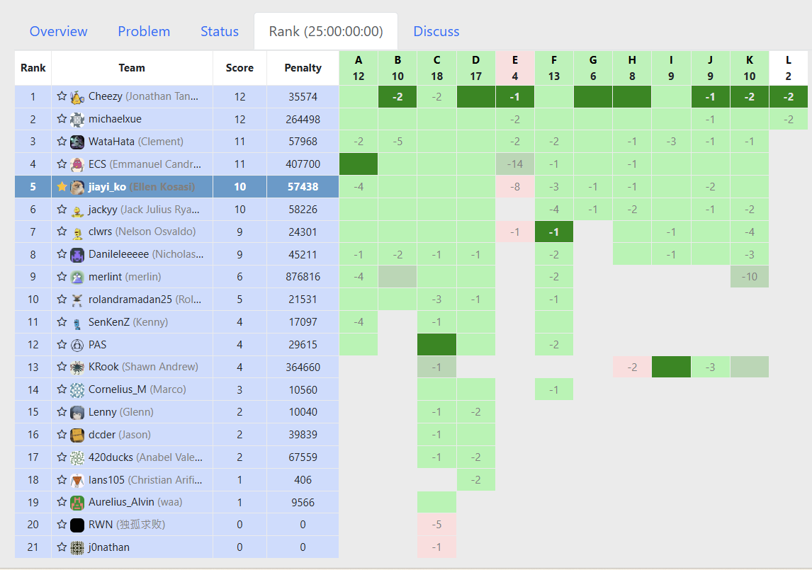
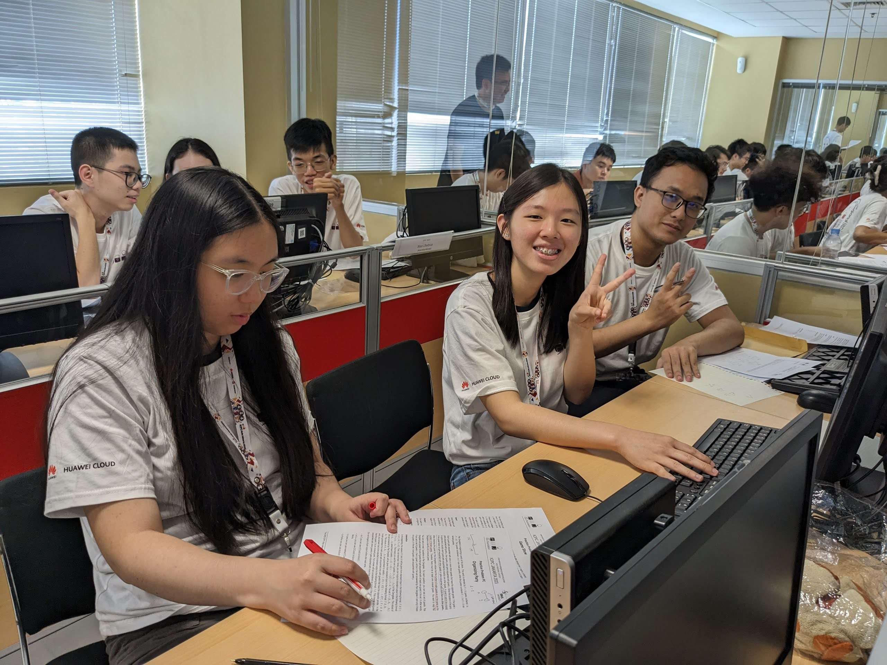
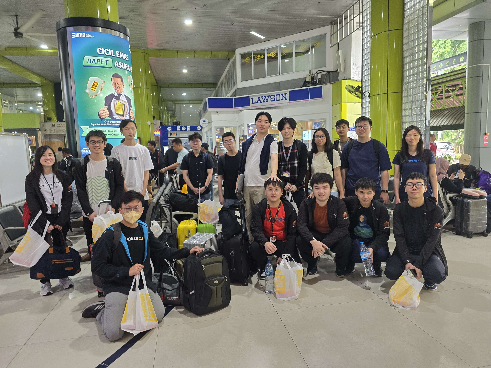
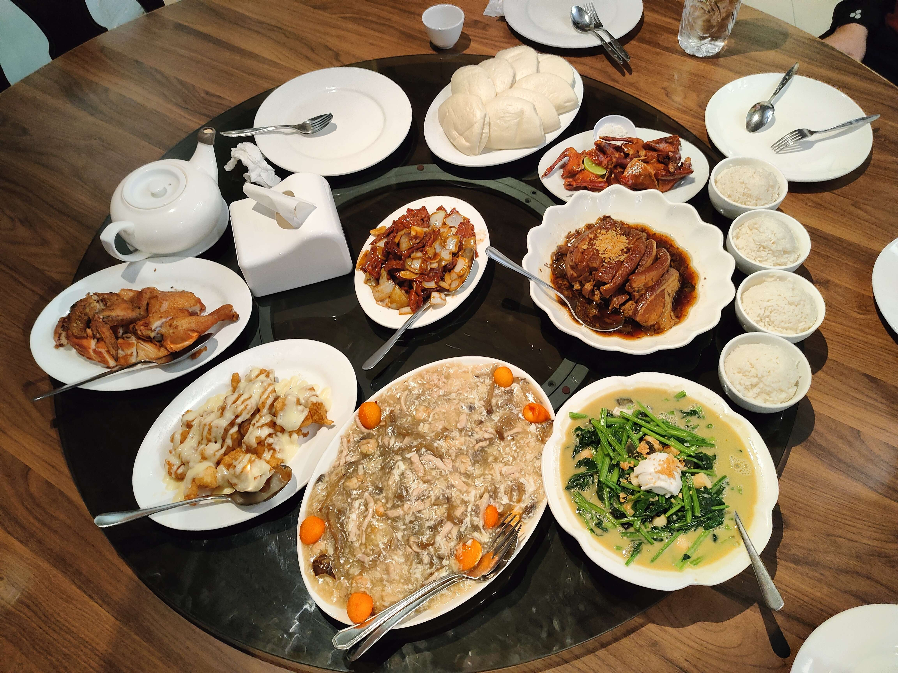
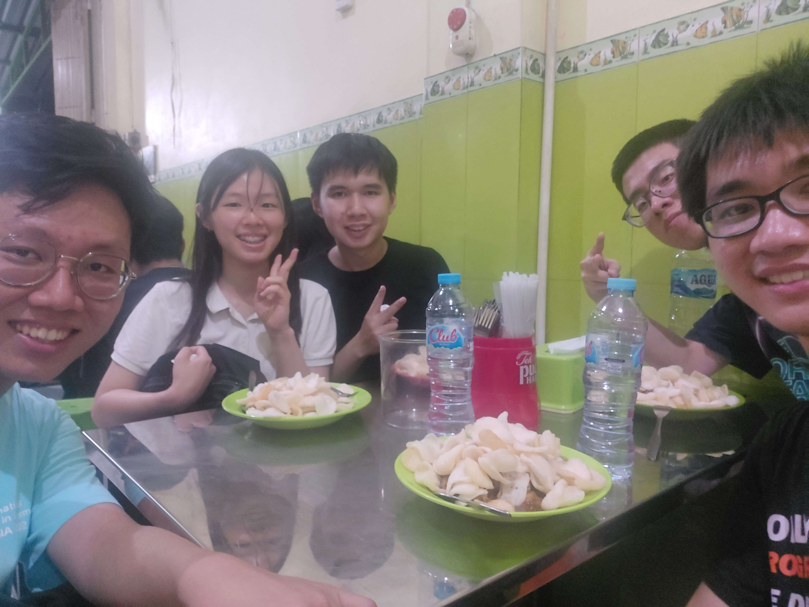
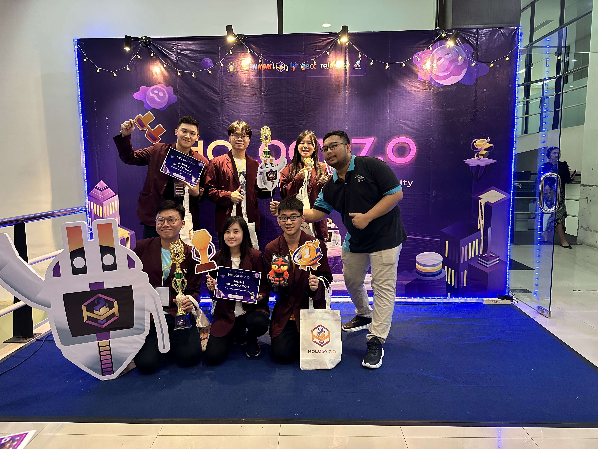
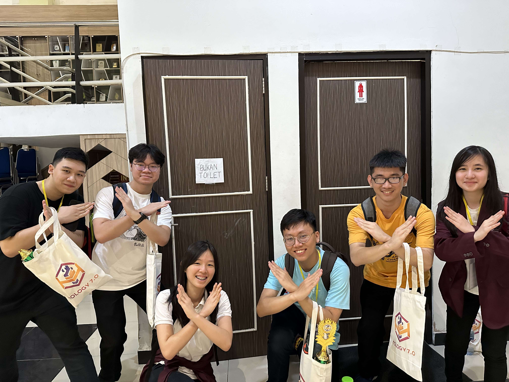
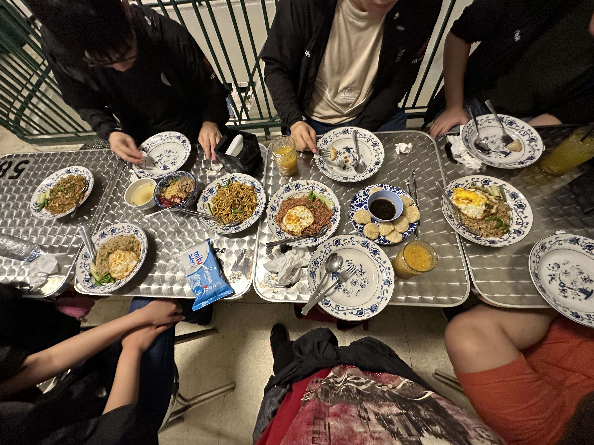

Aku kuliah S1 ambil jurusan Computer Science di BINUS Kemanggisan. Sebelumnya, aku awam dengan dunia komputer, cuman pernah ngoding manual tulis HTML di notepad karena pelajaran TIK sekolah 😂. Di bayanganku dulu, jurusan komputer -> benerin komputer wkwkwk.

Lah terus kenapa bisa berakhir di jurusan komputer? Karena dibujuk papa dan aku udah bingung mau ambil jurusan apa hahaha.

Singkat cerita, terdamparlah aku di BINUS. Di masa liburan panjang sebelum masuk kuliah, aku cari-cari tahu organisasi BINUS, dan dari situ ketemu info "Jollybee" (bukan ayam Jollibee ya, tolong). 

Jollybee = komunitas Competitive Programming (CP) di bawah School of Computer Science (SOCS) Binus. Dari Instagramnya, kegiatan mereka terlihat sangat menarik: belajar CP, lomba bareng (bisa keluar kota bareng), jalan-jalan bareng. Terlihat seperti komunitas yang sangat belajar tapi have fun bareng juga.

Sebagai orang yang kurang bersosialisasi semasa sekolah, aku sangat kepingin masuk Jollybee karena aku ingin dapat teman-teman solid. Kalau sering belajar dan main bareng, aku pikir mau tidak mau jadi dekat (konteks: aku takut tidak dapat teman karena kepribadianku agak kikuk).

Buat masuk Jollybee, ada seleksinya. Jollybee sendiri biasa sekitar 30-an orang. Aku ga pernah ngoding yang "serius" sebelumnya. Jadi, semasa liburan SMA ke kuliah aku coba belajar C++ dan basic CP di TLX (highly recommended untuk beginners :D).

Kalau diingat-ingat, dulu agak struggle belajar CP sendirian. Tiap kali solusiku salah, bingung mau nanya siapa (belum ada ChatGPT waktu itu), dan di lingkungan sekolahku tidak ada yang familiar dengan CP. Akhirnya, biasa aku buka solusi orang kalau sudah stuck, supaya bisa bandingin cara orang dengan caraku, dan ketemu salahnya di mana kira-kira.

Seleksi Jollybee ada dua tahap, diikuti dengan basic training selama satu semester jika lulus seleksi. Seleksinya diadakan di akhir semester 1 (November-Desember), dan basic training dimulai di awal semester 2 (Februari kalau tidak salah). Sejujurnya, aku tidak terlalu percaya diri dengan kemampuanku untuk bisa lolos seleksi Jollybee, apalagi aku baru belajar CP sekitar 3 bulan. Untuk seleksi tahap pertama, mayoritas soal-soal yang diujikan masih relatif mudah, tidak ada yang aneh-aneh. Untuk seleksi tahap kedua, aku jauh lebih kesusahan 😭. Aku masih ingat jelas waktu itu aku AC cuman 3 soal (AC = accepted, solusi benar). Aku sudah merelakan kalau tidak lolos karena yang peringkat teratas itu rata-rata AC 6 soal. Ternyata, aku lolos yey! Aku ingat waktu itu aku sangat hepi dan bertekad untuk sungguh-sungguh ikut basic training-nya dengan sebaik mungkin. Basic training-nya sendiri selalu di Binus Alam Sutera setiap hari Jumat. Aku masih ingat kami yang dari Binus Kemanggisan naik shuttle bus bareng pagi-pagi ke Alsut wkwkwk.

*Leader board latihan Dynamic Programming di Jollybasic.*

Karena hari Jumat adalah hari Jollybee latihan, jadwal kelas kuliah kami dimodifikasi supaya tidak ada kelas yang jatuh di hari Jumat. Jadi, biasanya anak-anak Jollybee dapat jadwal kelas yang mirip sehingga kami sering sekelas bareng. FYI, setiap pergantian semester di Binus kelasnya akan di-shuffle -> kemungkinan besar terpencar dengan teman-teman kita di semester sebelumnya 😭. Dari situ, aku berteman dengan 4 teman yang juga di Jollybee, yang kemudian jadi teman sepanjang kuliah sampai lulus 😂. Hampir semua aktivitas kuliah, seperti makan, kerja kelompok, rutinitas isi air ke ruang asisten lab (aslab) selalu kami lakukan berlima bersama. Kalau ada sela-sela waktu kosong di tengah dua kelas, kami juga suka kabur ke ruang Jollybee.

Selama waktuku di Jollybee, benar-benar waktu luang termakan habis buat latihan CP, tidak sempat explore bidang compsci yang lain. Latihan CP cukup memakan waktu yang lama karena sulit bagiku untuk cari solusi benar yang efisien (ada limit memori dan runtime-nya). Jadi, semisal logika solusi program kita benar, tetapi kalau waktu eksekusi programnya lambat, tetap dinilai tidak AC. 

Setiap hari Jumat, kita antara ada sesi materi atau latihan (disebut "kontes"). Durasi kontes 5 jam dan ada sekitar 10-13 soal, terkadang sifatnya individual, terkadang tim bertiga. Setelah kontes, biasa kita tinggal sebentar untuk mengobrol solusi soal-soal di kontes tadi. Setelah itu, beberapa dari kami biasa makan malam bareng di sekitar Binus 😋.

Aku berusaha menggunakan waktu luangku sebaik mungkin untuk latihan, seperti coret-coret solusi di note HP / notes kecil, saat naik bus Transjakarta pulang dari kuliah, sebelum kelas kuliah dimulai. Kadang beberapa dari kami ada yang latihan saat kelas sedang berlangsung wkwkwk (jangan ditiru).

Meskipun begitu, menurutku, perkembangan di CP itu sulit ditebak dan tidak linear. Analoginya, kita 2 tahun latihan CP dan latihan piano, probabilitas adanya "improvements yang pasti" itu lebih tinggi terlihat di piano dibandingankan di CP. Jujur, aku sendiri merasa perkembanganku di CP tidak sepesat itu, malah sebenarnya aku cukup kecewa dengan diriku sendiri. Sempat ada masa-masa di mana aku sangat sedih dengan performa CP-ku. 

Tujuan awalku masuk Jollybee adalah bisa keluar kota lomba bareng bersama teman-teman. Lomba-lomba CP kebanyakan diselenggarakan di semester ganjil (periode September-Desember, dan beberapa di Januari). Biasanya, lomba-lomba CP ada dua tahap: preliminary (online) dan final (on-site). Tahap final biasa diadakan langsung di universitas penyelenggara (yang berarti keluar kota bareng teman-teman).

Akan tetapi, ternyata sulit bagiku untuk sekadar tembus tahap final. Kukira setelah lolos basic training dan officially jadi member Jollybee (sekitar Agustus 2023), aku bisa ada kesempatan untuk lolos tahap final setidaknya sekali dalam periode semester ganjil (September 2023 - Januari 2024). Ternyata zonk, sampai September 2024 (sudah 2 tahun sejak mulai CP) aku masih sering jauh dari rentang peringkat untuk lolos final 😭. Sangat sedih and terpukul saat itu 🥲.

Sampai akhirnya, aku belajar untuk merelakan apa adanya. Aku mulai ikut lomba tanpa menaruh ekspektasi untuk bisa lolos ke final dan tetap mengusahakan yang terbaik dengan tujuan belajar suatu hal baru. Lucunya, tidak berapa lama, timku berhasil mengamankan peringkat terakhir untuk lolos ke tahap final 🎊. Ini adalah lomba pertamaku yang keluar kota (lomba NPC Schematics di ITS Surabaya). Aku ingat sangat hepi akhirnya diberi kesempatan oleh Tuhan untuk pergi final bareng teman-teman ke luar kota 🥹. We had a very great time di Surabaya :D.

*Di Stasiun Gambir. Naik kereta dari Jakarta ke Surabaya sekitar 8 jam.*

*Makan malam di restoran dekat hotel. Enak.*

*Makan malam tahu gimbal setelah lomba.*

Aku pikir tidak apa-apa jika pada akhirnya aku mendapatkan kesempatan final hanya sekali, yang penting sudah pernah merasakannya. Very grateful to God, setelah itu ternyata dapat kesempatan 2 kali lagi, ke Surabaya (ITS lagi) dan ke Malang (Universitas Brawijaya). Sejujurnnya, aku agak malu bilang sangat hepi meskipun hanya 3 kali final, karena dibandingkan teman-teman yang menggeluti bidang ini, bisa lolos tahap final dan keluar kota adalah hal yang sangat biasa.

*Foto di photo-booth setelah acara awarding.*

*Ini bukan toilet.*

*Makan malam 😋*

Setelah itu, tahun depan Februari 2025, aku tidak aktif lagi berpartisipasi lomba-lomba CP karena mulai program magang Binus selama setahun.  

Sekian lika-liku ringkasan singkat perjalananku di Jollybee. Ada banyak hal lucu dan berkenang yang tidak bisa kuceritakan satu per satu di blog ini. Meskipun target dan ekspektasi awalku banyak yang tidak tercapai, aku sudah sangat bersyukur dan hepi. Dari perjalanan ini, aku bertemu teman-teman yang keren, menarik, lucu/aneh (in a good way), coach yang baik dan suportif. Looking back, aku merasa kuliah = CP (Jollybee) + magang, daripada belajar di kelas kuliah 😂. Perjalanan Jollybee benar-benar mewarnai mayoritas waktuku di kuliah. Tanpa Jollybee, aku juga kemungkinan besar tidak akan dapat kesempatan magang ke luar negeri. 

Aku juga jadi bisa belajar bahwa rencana Tuhan yang terbaik. Aku sendiri awalnya masuk BINUS dengan berat hati (this is for another story), dan awal masuk Jollybee motivasinya hanya ingin dapat teman belajar dan main keluar kota bareng, tidak ada kepikiran sama sekali bahwa pengalaman ini bisa membawaku sejauh ini. Untuk teman-teman yang membaca blog ini, tetaplah mencoba meraih apa yang kalian inginkan, meskipun kalian ragu atau tidak percaya diri. Kalau berat, ambil satu langkah kecil. Dari mencoba, meskipun mungkin hasilnya tidak selalu bagus, setidaknya kita belajar suatu hal baru ⭐

